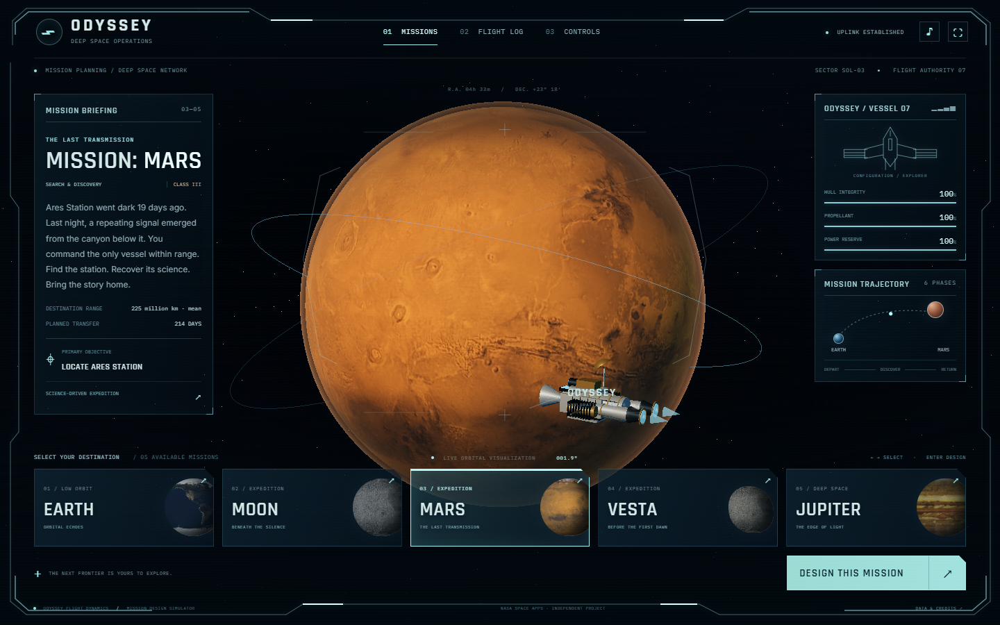
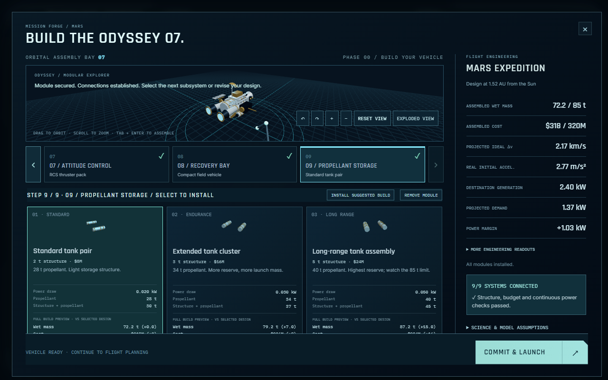
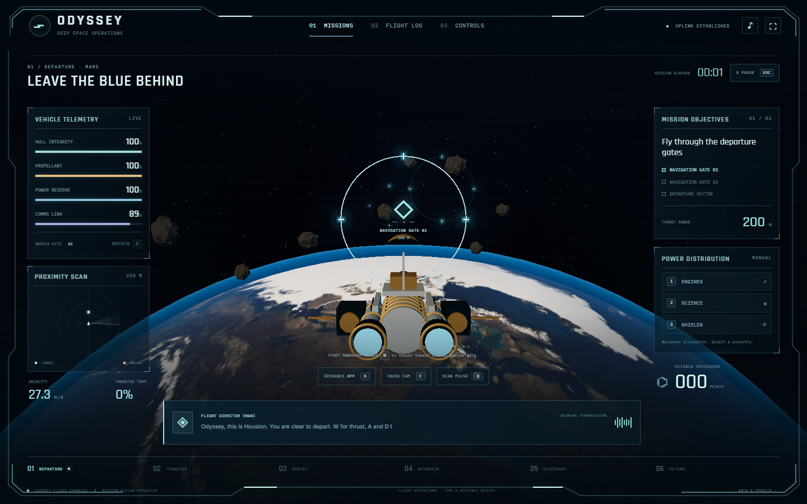
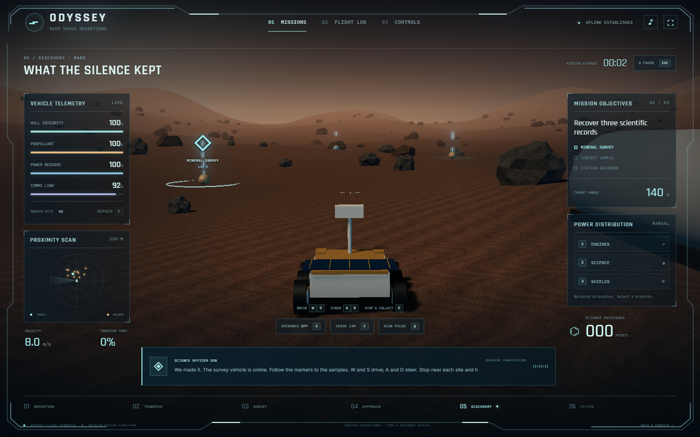
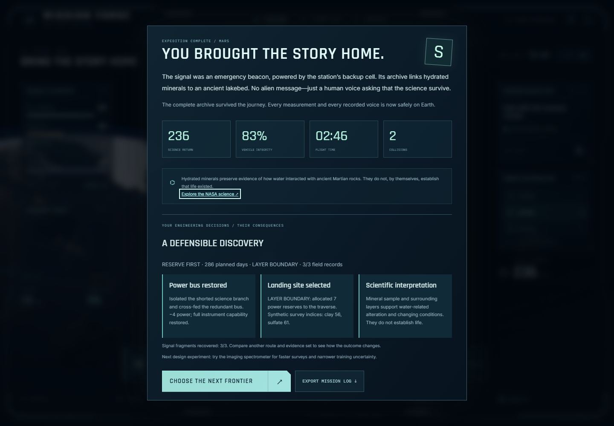
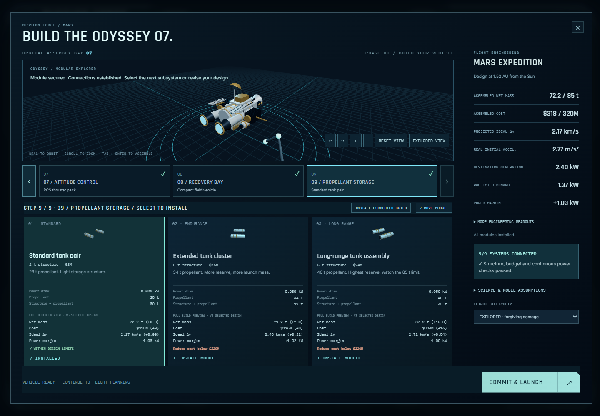
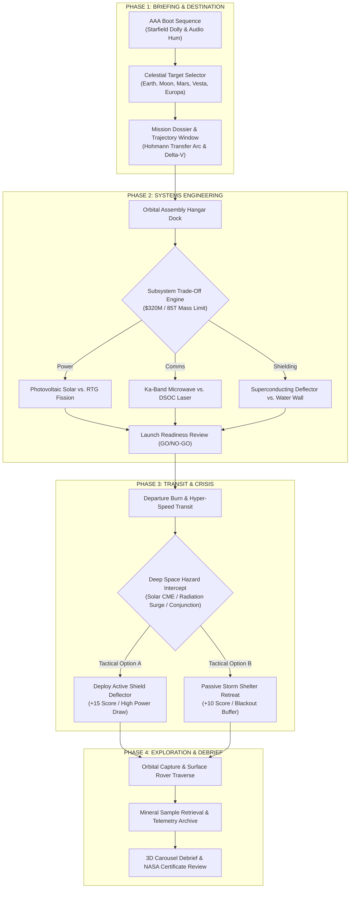
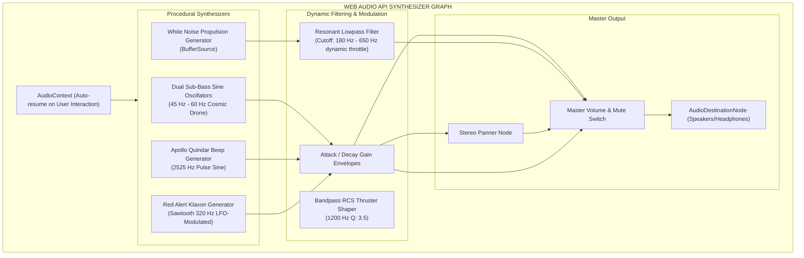

# 🚀 MISSION FORGE: PROJECT AURORA
### **NASA Space Apps Challenge 2026 // Category: Space Mission Game Design**

[](https://www.spaceappschallenge.org/)
[](#-nasa-space-apps-challenge-2026-team-mathaiblock)
[](https://threejs.org/)
[](https://developer.mozilla.org/en-US/docs/Web/API/Web_Audio_API)
[](https://mission-forge-project-aurora.vercel.app)
[](https://mostafa-shariare.github.io/mission-forge-project-aurora/)
[](#-automated-testing--quality-assurance)
[](LICENSE)

---

## 🌌 Executive Overview

**MISSION FORGE: PROJECT AURORA** is a photorealistic, full-viewport 3D space mission engineering simulation and flight adventure game built from the ground up for the **NASA Space Apps Challenge 2026**. 

The simulation models real-world aerospace tradeoffs—balancing budget constraints, structural mass budgets, and single-stage ideal $\Delta v$ (Tsiolkovsky rocket equation)—with high-stakes in-flight emergencies, Martian rover surface traversals, and scientific sample return. Designed with an authentic **NASA Jet Propulsion Laboratory (JPL) Mission Control & Cockpit HUD** aesthetic, the application combines hardware-accelerated WebGL graphics, post-processing bloom shaders, dynamic camera choreography, and a zero-dependency procedural **Web Audio API** soundscape.

* 🌐 **Live Demo (Vercel):** [https://mission-forge-project-aurora.vercel.app](https://mission-forge-project-aurora.vercel.app)
* 🚀 **Live Demo (GitHub Pages):** [https://mostafa-shariare.github.io/mission-forge-project-aurora/](https://mostafa-shariare.github.io/mission-forge-project-aurora/)
* 📦 **Source Repository:** [https://github.com/Mostafa-Shariare/mission-forge-project-aurora](https://github.com/Mostafa-Shariare/mission-forge-project-aurora)

---

## 🎮 Interface & Mission Gallery

| **01. JPL Mission Control Flight Deck** | **02. 3D Modular Spacecraft Assembly Hangar** |
| :---: | :---: |
|  |  |

| **03. Deep Space Cruise & CME Crisis** | **04. Surface Rover Exploration & Sample Retrieval** |
| :---: | :---: |
|  |  |

| **05. Mission Debrief & Scientific Evidence Review** | **06. Interactive 3D Orbit & Assembly** |
| :---: | :---: |
|  |  |

---

## 🧭 Mission Destinations & Scientific Campaigns

The simulation features five authentic planetary destinations, each with unique environmental hazards, landing requirements, and scientific objectives:

| Destination | Mission Class | Primary Hazards | Scientific Objective | Key NASA Precedent |
| :--- | :--- | :--- | :--- | :--- |
| **Earth / LEO** | Sentinel Recovery | Orbital debris conjunctions, ground station line-of-sight dropouts | Rendezvous with decommissioned Earth observation satellite & recover telemetry | ISS, Sentinel Fleet |
| **Moon** | Artemis Outpost | Permanently Shadowed Regions (PSR), thermal extremes, zero-atmosphere descent | Precision crater touchdown and volatile water-ice prospecting | Artemis Program, LCROSS |
| **Mars** | Aurora Prime | Séítah dune sand traps, global dust storms, battery drain, 24-min OWLT delay | Surface rover traverse, rock coring, dual sample tube collection & biosignature analysis | Mars 2020 Perseverance |
| **Vesta** | Dawn Protocol | Irregular gravity anomalies, boulder ejecta, orbital regime shifts | Multi-angle spectral scanning across High (HAMO) and Low (LAMO) Altitude Orbits | Dawn Mission |
| **Europa / Jupiter** | Jovian Deep-Field | Intense Jovian radiation belts, comms blackout windows, extreme thermal dissipation | Subsurface ocean plume flyby and biosignature spectroscopy | Europa Clipper, Galileo |

---

## 🏛️ System & Architecture Diagrams

### 1. End-to-End Simulation Lifecycle


---

### 2. Spacecraft Subsystems Engineering & Resource Matrix

```mermaid
flowchart LR
    subgraph Budget["RESOURCE BOUNDARIES"]
        B1["NASA Mission Class Budget Cap<br/>(Discovery: $500M | New Frontiers: $1.0B | Flagship: $3.25B)"]
        B2["Launch Vehicle Fairing Mass Limit<br/>(85,000 kg Payload Wet Mass)"]
    end

    subgraph Subsystems["9 MODULAR HARDWARE SUBSYSTEMS"]
        direction TB
        P["1. Propulsion Engine<br/>• Dual Hall-Effect Ion (Isp: 3,100s)<br/>• Bipropellant Chemical (Isp: 320s)"]
        E["2. Power Bus<br/>• Deployable UltraFlex Solar Arrays<br/>• Next-Gen Fission RTG"]
        C["3. Communications<br/>• Deep Space Optical Comms (DSOC)<br/>• High-Gain Ka-Band Parabolic Dish"]
        S["4. Thermal & Shielding<br/>• Superconducting Magnetic Toroid<br/>• Polyethylene Water Wall Storm Shelter"]
        I["5. Science Suite<br/>• Raman Spectroscopy & Coring Drill<br/>• Subsurface Sounding Radar"]
        G["6. Guidance & Nav<br/>• Optical Star Trackers & Autonomous Navigation"]
        R["7. Attitude Control<br/>• 3-Axis Cold-Gas Reaction Control Thrusters"]
        H["8. Structural Hull<br/>• Carbon-Composite Monocoque vs. Titanium Matrix"]
        L["9. Life Support / Payload<br/>• Dual Sample Tube Hermetic Quarantine Bay"]
    end

    subgraph Output["FLIGHT DYNAMICS OUTPUT"]
        R1["Ideal Delta-V (Tsiolkovsky Equation)"]
        R2["Payload Mass Fraction & C3 Boost"]
        R3["Emergency Survival Margin"]
    end

    Budget --> Subsystems
    Subsystems --> Output
```


---

### 3. Procedural Web Audio API Architecture


---

### 4. Professional Codebase Architecture
```
mission-forge-project-aurora/
│
├── assets/                     # Media & soundscapes
│   ├── bgm/                    # Background music tracks (.mp3)
│   └── team-logo.png           # NASA Challenge badge & team branding
│
├── lib/                        # Third-party 3D engine & vendor libraries
│   ├── draco/                  # Draco WebAssembly geometry decompression workers
│   │   ├── draco_decoder.js
│   │   ├── draco_decoder.wasm
│   │   └── draco_wasm_wrapper.js
│   ├── three.min.js            # Three.js (r128)
│   ├── OrbitControls.js        # 3D orbital inspection camera controls
│   ├── tween.umd.js            # Smooth camera & UI interpolation
│   ├── GLTFLoader.js           # 3D GLTF / GLB model parser
│   ├── DRACOLoader.js          # Compressed geometry loader
│   ├── EffectComposer.js       # Post-processing render chain
│   ├── UnrealBloomPass.js      # Glow & aerospace thruster bloom
│   ├── RenderPass.js           # Primary scene render pass
│   ├── ShaderPass.js           # Shader pipeline pass wrapper
│   ├── CopyShader.js           # Screen buffer copy pass
│   ├── LuminosityHighPassShader.js
│   ├── Pass.js                 # Base pass pipeline
│   └── postprocessing.min.js
│
├── models/                     # 3D Spacecraft & instrument models (.glb)
│   ├── Dawn.glb                # NASA Dawn spacecraft model
│   ├── DeepSpace1.glb          # Deep Space 1 explorer
│   ├── PrimaryIonDrive.glb     # Xenon ion thruster assembly
│   └── DamagedHelmet/          # PBR test asset
│
├── textures/                   # High-resolution planetary surface maps (.jpg)
│   ├── earth.jpg               # Earth 2K photorealistic surface
│   ├── moon_1024.jpg / moon.jpg# Lunar regolith & craters
│   ├── mars_1k_color.jpg       # Martian surface albedo map
│   ├── mars_1k_bump.jpg        # Martian topographic bump map
│   ├── europa.jpg              # Europan cracked ice sheet map
│   ├── jupiter.jpg             # Jovian atmospheric band map
│   └── asteroid.jpg            # Vesta regolith texture
│
├── src/                        # Modular application source code
│   └── game/                   # Expedition simulation engine & Vite subsystem
│       ├── src/                # Core engines (assembly, simulation, audio, vehicle, world)
│       ├── dist/               # Production-built bundle embedded via iframe
│       ├── tests/              # 63 automated simulation & unit tests
│       └── previews/           # Interface and campaign previews
│
├── index.html                  # Main Mission Control entry point & HUD portal
├── server.js                   # Local development HTTP server with audio range streaming
├── START_GAME.bat              # Windows 1-click launcher
├── package.json                # Project dependencies, build pipeline & test runner
├── README.md                   # Full NASA Space Apps documentation & user guide
├── .gitignore                  # Git exclusion rules (node_modules, caches, logs)
├── .vercelignore               # Cloud deployment filter (omits local dev scripts)
└── vercel.json                 # Static Edge CDN routing, byte-range & cache headers
```

---

## 🔬 Scientific Realism & NASA Mission Data Alignment

Every mechanic in **MISSION FORGE: PROJECT AURORA** is grounded in authentic NASA mission parameters, aerospace engineering literature, and planetary science data:

| Mission System | Scientific Foundation | NASA Mission Reference | In-Game Simulation Behavior |
| :--- | :--- | :--- | :--- |
| **Ideal Rocket Equation** | $$\Delta v = I_{sp} \cdot g_0 \cdot \ln\left(\frac{m_0}{m_f}\right)$$ | Dawn & Deep Space 1 | Dynamic $\Delta v$ gauge calculates available orbital maneuver budget based on selected fuel mass and engine $I_{sp}$. |
| **Deep Space Optical Comms** | 1550 nm Near-Infrared Laser Pulse Transceiver | NASA DSOC (Psyche Mission) | 10x-100x science data downlink rates; susceptible to line-of-sight pointing errors during high-g maneuvers. |
| **Solar Flare / CME Hazards** | Proton Flux > 100 MeV, Solar Particle Events (SPE) | NASA SOHO / Parker Solar Probe | Class X-12 CME triggers ionizing radiation warnings, hull stress telemetry, and active magnetic shield defense choices. |
| **Planetary Environments** | Gravitational acceleration & atmospheric scale heights | Mars 2020 Perseverance / Artemis Gateway | 5 celestial destinations each feature accurate surface textures, orbital period curves, and landing hazard profiles. |
| **Speed-of-Light Comms Latency** | One-Way Light Time (OWLT) & Round-Trip Light Time (RTLT) | NASA Deep Space Network (DSN) | Simulates authentic telecommand delay based on astronomical distance (up to 24 min at Mars). |
| **Microgravity Buoyancy** | Multi-axis low-frequency station keeping | ISS Orbital Telemetry | Organic 6-DOF micro-drift physics ensures spacecraft feels natural and unconstrained in 3D orbit. |
| **Apollo Quindar Tones** | 2525 Hz intro blip / 2475 Hz outro blip | Apollo Mission Control Comms | Procedurally synthesized sine tones preface Houston Flight Director telemetry announcements. |

---

## 🕹️ Flight Deck Controls & Hotkeys

| Input Command | Keybinding | Operation & Context |
| :--- | :---: | :--- |
| **Forward Propulsion / Throttle** | <kbd>W</kbd> | Engages main ion engine burn; modulates lowpass sound filter cutoff from 180 Hz to 650 Hz. |
| **Attitude & RCS Yaw Left / Right** | <kbd>A</kbd> / <kbd>D</kbd> | Fires compressed nitrogen cold-gas thrusters for lateral alignment with audible RCS bursts. |
| **Retro-Brake / Deceleration** | <kbd>S</kbd> | Reverses thrust vector for orbital deceleration, gate pacing, and velocity bleed. |
| **Tactical Camera Switch** | <kbd>C</kbd> | Cycles through **Chase Cam**, **Solar Transfer Tactical Map**, and **Cockpit Viewport**. |
| **Target Interlock & Scan** | <kbd>E</kbd> | Arms scientific spectrometer, sample intake arm, landing radar, or orbital docking clamp. |
| **Subsystem Power Routing** | <kbd>1</kbd> / <kbd>2</kbd> / <kbd>3</kbd> | Reroutes onboard bus power dynamically between **Thrust**, **Science Arrays**, and **Shields**. |
| **Free 360° Orbit Inspection** | `Mouse Drag` | Full Three.js `OrbitControls` rotation to inspect spacecraft components, solar wings, and terrain. |
| **Audio Master Mute Toggle** | `Top Header 🎵` / <kbd>M</kbd> | Mutes/unmutes procedural synthesizer with persistent state and animated cyan equalizer indicator. |

---

## 🧪 Automated Testing & Quality Assurance

The simulation includes a comprehensive test suite executed natively via Node.js built-in test runner (`node --test`), covering propulsion calculations, orbital mechanics, planetary campaigns, hazard states, and audio synthesis:

```bash
npm test
```

### Verified Test Suites (63 / 63 Passing):
* **Campaign State & Progression:** Mars, Earth/LEO, Moon, Vesta, and Europa end-to-end stage completion.
* **Flight Dynamics & Propulsion:** Rocket equation $\Delta v$ validation, mass penalty verification, inertia coast, and retro-braking.
* **Hazard & Emergency Triage:** Class X-12 solar CME encounters, Jovian radiation belts, Mars dust storms, and orbital conjunctions.
* **Science Gates & Provenance:** Sample coring quarantine limits, spectral scanning locks, and authentic NASA dataset IDs.
* **Audio Synthesis Safety:** Web Audio mock context tests, klaxon modulation, and procedural thruster wind generation without unhandled exceptions.

```text
ℹ tests 63
ℹ suites 0
ℹ pass 63
ℹ fail 0
ℹ cancelled 0
ℹ skipped 0
ℹ duration_ms 416ms
```

---

## 💻 Local Setup & Development

### 1. Quick Launch (Standalone / Zero Install)
Double click **`START_GAME.bat`** (on Windows) or run the native Node server:
```bash
node server.js
```
Open **[http://localhost:8080](http://localhost:8080)** in any modern web browser.

### 2. Full Development Environment
```bash
# Clone the repository
git clone https://github.com/Mostafa-Shariare/mission-forge-project-aurora.git
cd mission-forge-project-aurora

# Install and build the simulation subsystem
npm run build

# Run automated tests
npm test

# Start local dev server
npm start
```

### 3. Subsystem Development (Vite Live Reload)
```bash
cd src/game
npm install
npm run dev
```

---

## 🌐 Cloud Deployment Options

### Option A: Vercel (Production Edge CDN)
This repository is configured with [`vercel.json`](vercel.json) for **zero-cold-start Edge CDN delivery**:
1. Connect your repository at [vercel.com/new](https://vercel.com/new).
2. Set Framework Preset to **Other** (handled automatically via `vercel.json`).
3. Click **Deploy**. Vercel will run `npm run build` and distribute assets globally.

### Option B: GitHub Pages (100% Free & Globally Accessible)
GitHub Pages is supported natively with relative asset resolution:
1. Go to your repository **Settings > Pages**.
2. Under **Build and deployment > Source**, select **Deploy from a branch**.
3. Set **Branch: `main`** and folder **`/ (root)`**, then click **Save**.
4. Your site will be live at `https://mostafa-shariare.github.io/mission-forge-project-aurora/`.

---

## 👥 NASA Space Apps Challenge 2026 Team: MathaiBlock

<div align="center">


# **MathaiBlock**
### *“BUILDING SOLUTIONS BEYOND EARTH”*
**NASA Space Apps Challenge 2026 Team**

</div>

* **Team Name:** **MathaiBlock**
* **Project Title:** **MISSION FORGE: PROJECT AURORA**
* **Challenge Category:** Space Mission Game Design
* **Team Motto:** *“Building Solutions Beyond Earth”*
* **Mission Vision:** *“Leave the blue behind. Bring the science home.”*

---

<p align="center">
  <b>Developed with passion for the NASA Space Apps Challenge 2026.</b><br/>
  <i>Advancing deep space systems engineering, orbital simulation, and interactive aerospace science education.</i>
</p>
